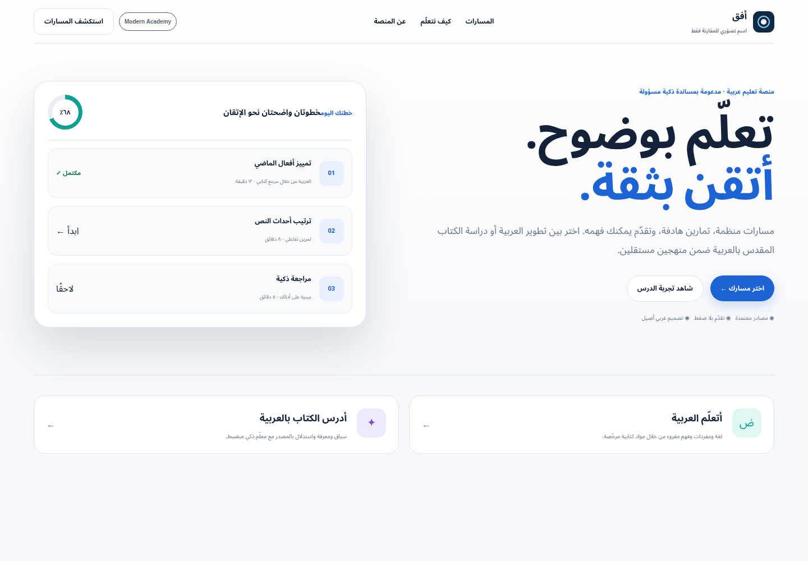
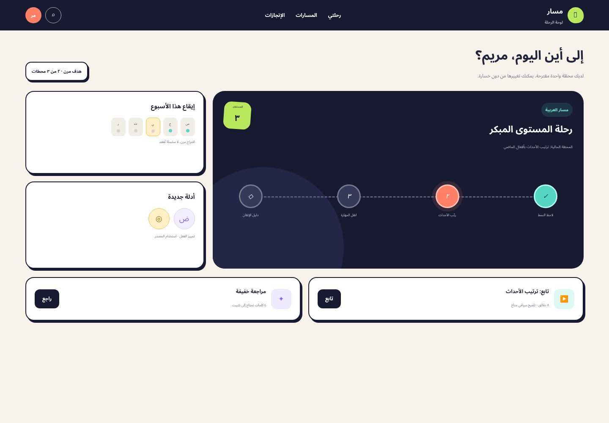
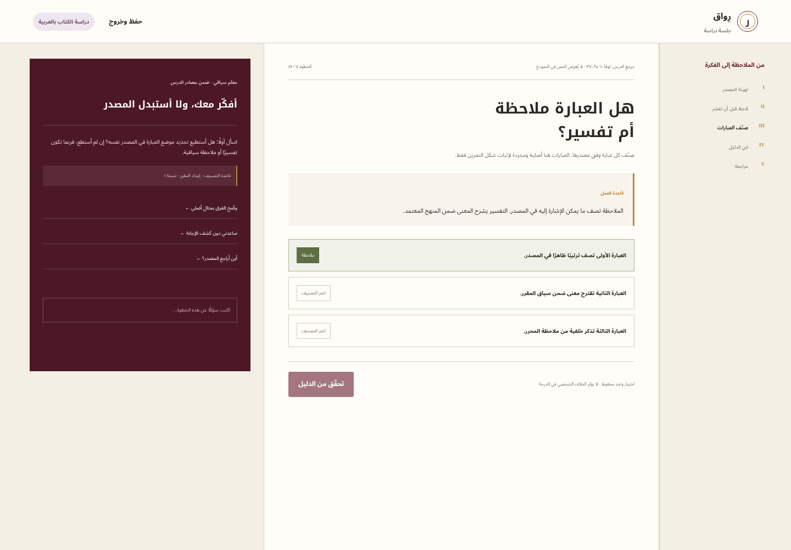

# Mission 00C concept comparison

**Decision requested:** select one direction for detailed production design in Mission 01A, request a bounded revision, or pause. The existing Mission 00A interface and its “مدار” identity are not visual references for this work.

All names and logos in these previews are comparison devices only. All lesson text is original conceptual copy; the previews contain references rather than reproduced Bible passages. No interaction, AI response, progress value, course, or brand shown here is a production claim.

## Required views at a glance

| Direction | Landing | Learner dashboard | Lesson with contextual tutor |
| --- | --- | --- | --- |
| A — Modern Academy | [Open preview](previews/concept-a-modern-academy.html?screen=landing) | [Open preview](previews/concept-a-modern-academy.html?screen=dashboard) | [Open preview](previews/concept-a-modern-academy.html?screen=lesson) |
| B — Learning Quest | [Open preview](previews/concept-b-learning-quest.html?screen=landing) | [Open preview](previews/concept-b-learning-quest.html?screen=dashboard) | [Open preview](previews/concept-b-learning-quest.html?screen=lesson) |
| C — Contemporary Scholar | [Open preview](previews/concept-c-contemporary-scholar.html?screen=landing) | [Open preview](previews/concept-c-contemporary-scholar.html?screen=dashboard) | [Open preview](previews/concept-c-contemporary-scholar.html?screen=lesson) |

The standalone preview toolbar changes screens for review. Product-like calls to action inside each composition are static to avoid suggesting implemented behavior.

## A — Modern Academy

A calm, structured learning environment with a precise grid, navy and blue foundation, and restrained path accents. The dashboard emphasizes the next lesson and observable progress. The lesson creates a clear hierarchy among outline, activity, and contextual tutor.

| Mobile evidence | Desktop evidence |
| --- | --- |
| [Landing, 390 px](screenshots/a-modern-academy-landing-mobile.png) | [Landing, 1440 px](screenshots/a-modern-academy-landing-desktop.png) |
| [Dashboard, 390 px](screenshots/a-modern-academy-dashboard-mobile.png) | [Dashboard, 1440 px](screenshots/a-modern-academy-dashboard-desktop.png) |
| [Lesson, 390 px](screenshots/a-modern-academy-lesson-mobile.png) | [Lesson, 1440 px](screenshots/a-modern-academy-lesson-desktop.png) |

**Best qualities:** hierarchy, Arabic reading comfort, accessible interaction states, responsive clarity, and cross-subject durability.
**Watch-outs:** without thoughtful Arabic editorial content and distinct exercise visuals, the system could resemble generic learning software.

## B — Learning Quest

A route-based experience with vivid milestone colors, a sense of forward movement, and flexible weekly goals. Gamification describes demonstrated learning and attainable next steps. It avoids public competition and loss-framed streaks.

| Mobile evidence | Desktop evidence |
| --- | --- |
| [Landing, 390 px](screenshots/b-learning-quest-landing-mobile.png) | [Landing, 1440 px](screenshots/b-learning-quest-landing-desktop.png) |
| [Dashboard, 390 px](screenshots/b-learning-quest-dashboard-mobile.png) | [Dashboard, 1440 px](screenshots/b-learning-quest-dashboard-desktop.png) |
| [Lesson, 390 px](screenshots/b-learning-quest-lesson-mobile.png) | [Lesson, 1440 px](screenshots/b-learning-quest-lesson-desktop.png) |

**Best qualities:** momentum is immediately visible; route and checkpoint patterns naturally support short practice and remediation.
**Watch-outs:** visual density and maintenance cost are higher. Strong color, route animation, reward language, or mascot-like illustration could quickly violate the professional, non-pressuring direction.

## C — Contemporary Scholar

A contemporary editorial environment built around a reading desk, folios, annotations, and source layers. Warm parchment, oxblood, olive, and plum create a reflective tone. The lesson's marginal notes make the difference between source, interpretation, and generated explanation tangible.

| Mobile evidence | Desktop evidence |
| --- | --- |
| [Landing, 390 px](screenshots/c-contemporary-scholar-landing-mobile.png) | [Landing, 1440 px](screenshots/c-contemporary-scholar-landing-desktop.png) |
| [Dashboard, 390 px](screenshots/c-contemporary-scholar-dashboard-mobile.png) | [Dashboard, 1440 px](screenshots/c-contemporary-scholar-dashboard-desktop.png) |
| [Lesson, 390 px](screenshots/c-contemporary-scholar-lesson-mobile.png) | [Lesson, 1440 px](screenshots/c-contemporary-scholar-lesson-desktop.png) |

**Best qualities:** distinctive Arabic editorial character, excellent conceptual fit for source-grounded study, and a strong way to label layers of meaning.
**Watch-outs:** editorial density needs simplification on small screens; texture, serif typography, and ornamental references could reduce readability. The metaphor is less immediately portable to future practical or technical subjects.

## Comparative assessment

Scores are internal design assessment on a five-point scale, based on the current static artifacts and project constraints. They are not user-testing results.

| Criterion | A Academy | B Quest | C Scholar |
| --- | :---: | :---: | :---: |
| Premium, professional character | 5 | 4 | 5 |
| Native Arabic/RTL composition | 5 | 4 | 5 |
| Clear learning hierarchy | 5 | 4 | 4 |
| Thoughtful motivation | 4 | 5 | 3 |
| Source/interpretation clarity | 4 | 3 | 5 |
| Mobile simplification | 5 | 4 | 3 |
| Accessibility risk | 5 | 3 | 4 |
| MVP implementation economy | 5 | 3 | 3 |
| Future-subject extensibility | 5 | 4 | 3 |
| Distinctiveness | 4 | 5 | 5 |

“Accessibility risk” is scored higher when risk is lower. Any approved direction still requires the manual and automated validation in [ACCESSIBILITY.md](ACCESSIBILITY.md).

## Recommendation

Select **A — Modern Academy** as the core direction. It gives Mission 01A the strongest foundation for Arabic typography, clear exercises, accessible state design, small-team maintenance, and future subjects. Its restrained system can support meaningful progress without making the product feel childish.

Two patterns merit controlled follow-up inside A if the owner approves them: C's explicit source/interpretation/generated-explanation labels and B's compact course-route view. These are component behaviors, not a proposal to merge three visual identities.

## Decision questions

1. Is A, B, or C approved as the production direction?
2. Should the approved direction be tested in light mode only for the first MVP, or should dark mode enter Mission 01A scope?
3. Is the initial learner audience adults only, older teens and adults, or a broader age range requiring child-specific safeguards?
4. Should English appear only in learning content when pedagogically useful, or also as an optional interface language?
5. May Mission 01A test the two bounded patterns recommended above, or must it follow the selected concept without borrowing them?
